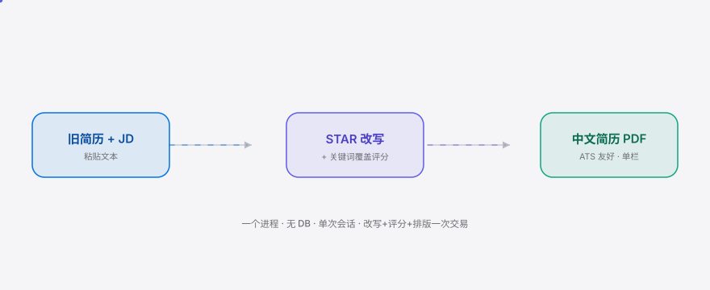
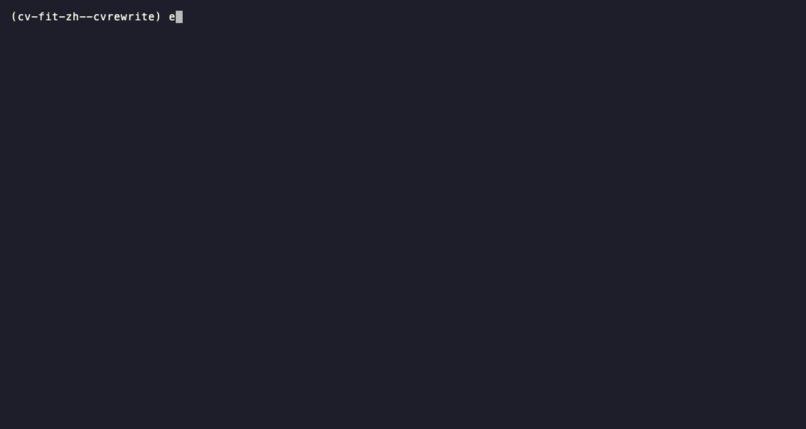

**English** | [简体中文](./README.md)

<p align="center">
<picture>
  <source media="(prefers-color-scheme: dark)" srcset="./assets/hero-dark.svg">
  <source media="(prefers-color-scheme: light)" srcset="./assets/hero-light.svg">
  
</picture>
</p>

<p align="center"><sub>For Chinese job seekers: turn an old resume into a JD-aligned, ATS-friendly Chinese resume PDF in one pass — with keyword coverage scoring, priced per application.</sub></p>

<p align="center">
  <a href="./LICENSE"></a>
  <a href="https://github.com/SuperMarioYL/cv-fit-zh/releases"></a>
  <a href="https://github.com/SuperMarioYL/cv-fit-zh/actions/workflows/ci.yml"></a>
  
</p>

**Paste an old resume + a job description, get an ATS-friendly, keyword-coverage-visualized Chinese resume PDF in 30 seconds — rewrite, score, and typeset in a single transaction.**

<h2> Architecture</h2>

<p align="center">
<picture>
  <source media="(prefers-color-scheme: dark)" srcset="./assets/atlas-dark.svg">
  <source media="(prefers-color-scheme: light)" srcset="./assets/atlas-light.svg">
  
</picture>
</p>

One Python process, three layers:

- **Web layer** (FastAPI + Jinja2): a single page with two text boxes + a generate button, POSTing to `/api/rewrite` then `/api/export`.
- **LLM workflow layer**: DeepSeek-V3 primary, Qwen2.5 fallback (OpenAI-compatible). JD parsing → STAR rewrite → keyword-coverage scoring; about 3 calls per rewrite.
- **Format-asset layer**: the Chinese ATS template (SimSun/Source Han Serif, 2cm margins, single-column, no tables so domestic ATS parsers don't break) + weasyprint PDF / python-docx fallback. This is the moat.

The core primitive is the **JD-aligned resume document** (`JDResume`): each experience bullet paired with its STAR rewrite and the JD keywords it covers.

## Table of contents

- [Why this exists](#why-this-exists)
- [Install & quickstart](#install--quickstart)
- [Usage](#usage)
- [Demo](#demo)
- [Configuration](#configuration)
- [Pricing](#pricing)
- [Roadmap](#roadmap)
- [License](#license)

## Why this exists

A Chinese job seeker tailoring a resume before an application uses two tools today: paste the old resume into Doubao/ChatGPT for a rewrite and get a pile of prose bullets — no keyword-coverage score, no ATS-friendly Chinese typesetting, and you still re-typeset it yourself in Word or a template site. The pain isn't "I can't write" — it's "I can't *produce a JD-aligned, recruiter-legible, correctly formatted Chinese resume* in one shot." cv-fit-zh collapses rewrite + scoring + typesetting into one transaction: one JD, one old resume, a submittable PDF in 30 seconds.

> In 2026, LLM one-shot structured rewriting crossed the reliability threshold (JD parsing + STAR rewrite at sub-¥1/resume), career-ops (62k stars) made "JD → resume tailor" a legible workflow unit, and domestic ATS keyword filtering tightened as application volume rose — all three landed together, which is what makes this viable now.

| Dimension | Doubao/ChatGPT chat | Resume template sites | career-ops (dev CLI) | **cv-fit-zh** |
|---|---|---|---|---|
| JD-driven STAR semantic rewrite | ✓ prose bullets | weak AI rewrite | ✓ (English) | ✓ |
| JD keyword-coverage visualization | — | — | — | ✓ |
| Chinese ATS typesetting/fonts/margins | — | ✓ | — | ✓ |
| Install-and-go (non-developer) | ✓ | ✓ | — | ✓ |
| One-shot submittable PDF | — | manual fill-in | — | ✓ |

## Install & quickstart

```bash
git clone https://github.com/SuperMarioYL/cv-fit-zh && cd cv-fit-zh
pip install -e .
# Start the server (set a DeepSeek/Qwen key below for rewrites; parsing + coverage work offline without one)
DEEPSEEK_API_KEY=sk-xxx uvicorn app.main:app
```

Open `http://localhost:8000`, paste your old resume + a JD → Generate → download the PDF.

<details><summary>Or use uv / a virtualenv</summary>

```bash
uv venv --python 3.12 && source .venv/bin/activate
uv pip install -e ".[dev]"
uvicorn app.main:app
```

weasyprint needs system libs pango/cairo (macOS: `brew install pango cairo`; Ubuntu: `apt install libpango-1.0-0 libcairo2`).
</details>

## Usage

<h2> CLI & API</h2>

**1. CLI: parse a JD (no key needed — works offline)**

```bash
python -m app.jd.parser --jd examples/sample.jd.txt
# → {"title": "后端开发工程师（Python）", "must_skills": ["Python","SQL","分布式",...]}
```

**2. CLI: full pipeline — old resume + JD → STAR rewrite + coverage**

```bash
python -m app.resume.star --resume examples/sample.resume.txt --jd examples/sample.jd.txt
# → JDResume JSON, including rewritten[].star and coverage.score
```

**3. Web API** (FastAPI, single-page UI at `/`)

```bash
# Rewrite
curl -s localhost:8000/api/rewrite \
  -H 'Content-Type: application/json' \
  -d '{"resume_text":"...","jd_text":"..."}' | jq '.coverage'

# Export PDF
curl -s localhost:8000/api/export \
  -H 'Content-Type: application/json' \
  -d '{"jd":...,"resume":...,"rewritten":...,"coverage":...,"format":"pdf","watermark":true}' \
  -o resume.pdf
```

More examples in [`examples/`](./examples).

<h2> Demo</h2>



30 seconds: paste an old resume + JD → STAR rewrite → keyword-coverage score → download a Chinese resume PDF. The recording uses the offline CLI path (no API key needed); the web UI runs the same flow.

## Configuration

Configured via environment variables — no config file required to boot (only rewrites need an LLM key; parsing and coverage scoring work offline):

| Env var | Type | Default | Meaning |
|---|---|---|---|
| `DEEPSEEK_API_KEY` | str | empty | DeepSeek-V3 primary key (or `OPENAI_API_KEY`) |
| `DASHSCOPE_API_KEY` | str | empty | Qwen2.5-72b fallback key |
| `CVFIT_PRIMARY_MODEL` | str | `deepseek-chat` | primary model name |
| `CVFIT_FALLBACK_MODEL` | str | `qwen-plus` | fallback model name |
| `CVFIT_HOST` / `CVFIT_PORT` | str/int | `127.0.0.1` / `8000` | server bind |
| `CVFIT_FREE_QUOTA` | int | `1` | free watermarked rewrites/day (in-process, no DB) |
| `CVFIT_WATERMARK` | str | `cv-fit-zh 生成` | free-tier watermark text |
| `CVFIT_TEMPERATURE` | float | `0.3` | LLM temperature |

## Pricing

> A commercial product, priced per application. Open-source core, fully free to self-host.

- **Self-host is free**: run locally with full functionality, no watermark, no limits. That's the "open-source core" boundary — the tool itself is free.
- **¥9.9 / application (unwatermark)**: a stub in v0.1 — local runs are free 1×/day with a "cv-fit-zh 生成" watermark; pay ¥9.9 to remove it. v0.1 routes the first payment manually via WeChat transfer (to validate willingness-to-pay); real online payment lands in v0.2.
- **Per-resume economics**: ~3 DeepSeek-V3 calls per rewrite, ~2k tokens each, sub-¥1 cost — leaving ~10× margin against the ¥9.9/application price.
- **v0.2 roadmap**: evaluate a ¥39/month autumn-recruitment season pass (unlimited); real payment (WeChat Pay scan) + object storage for unwatermarked PDF download links.

Why charge when the core is open? You pay for the *convenience of unwatermarked hosted delivery*, not a feature lock — self-hosting is always fully free.

## Roadmap

- [x] **m1 week-0 demand probe** (V2EX/Sspai/Xiaohongshu falsification gate — passed → proceeded to build)
- [x] **m2 JD + old-resume structured parsing** (title/skills/responsibilities/experience entries)
- [x] **m3 experience STAR rewrite + keyword-coverage scoring** (matched/missing/score)
- [x] **m4 Chinese ATS typesetting + PDF/docx export + web UI** (first release)
- [ ] v0.2 real payment (WeChat Pay) + automated unwatermark delivery
- [ ] v0.2 JD auto-scraping evaluation (Boss/Liepin/Zhaopin — anti-bot/risk TBD)
- [ ] v0.2 multiple Chinese typesetting templates + light in-app editor
- [ ] v0.3 hosted form (self-host free + hosted paid — not multi-tenant SaaS)

## License

[MIT](./LICENSE). Issues and PRs welcome at the [issue tracker](https://github.com/SuperMarioYL/cv-fit-zh/issues).

<p align="center"><sub><a href="./LICENSE">MIT</a> © 2026 SuperMarioYL</sub></p>
