[简体中文](./README.md) · [Website](https://cv-fit-zh.lei6393.com) · [GitHub](https://github.com/SuperMarioYL/cv-fit-zh)

<picture>
  <source media="(max-width: 600px) and (prefers-color-scheme: dark)" srcset="./assets/presentation/hero-mobile-dark.svg">
  <source media="(max-width: 600px)" srcset="./assets/presentation/hero-mobile-light.svg">
  <source media="(prefers-color-scheme: dark)" srcset="./assets/presentation/hero-dark.svg">
  
</picture>

# cv-fit-zh

**See how your experience matches a job description**

cv-fit-zh pairs a Chinese resume with a target job description, structures the input, optionally rewrites experience bullets, and exports a document with visible keyword coverage.

## Why use it

When adapting a resume, it is easy to change the wording without checking whether the job’s required skills are represented. A shared JDResume object keeps the original experience, rewritten bullets and coverage result together for review and export.

- **Keep original context** — Each rewritten bullet retains its original text for comparison.
- **Explain coverage** — Matched and missing keywords accompany the numeric score.
- **Export the same result** — PDF and DOCX rendering reuse structured data without repeating the rewrite.

## Architecture

<picture>
  <source media="(max-width: 600px) and (prefers-color-scheme: dark)" srcset="./assets/presentation/architecture-mobile-dark.svg">
  <source media="(max-width: 600px)" srcset="./assets/presentation/architecture-mobile-light.svg">
  <source media="(prefers-color-scheme: dark)" srcset="./assets/presentation/architecture-dark.svg">
  
</picture>

JD and resume parsers create Pydantic models. The rewrite stage asks a configured OpenAI-compatible client for STAR-style bullets and falls back to the original text when unavailable. The active rewrite pipeline uses one deterministic coverage matcher for both its score and highlights. Export renders the assembled JDResume through Jinja2/WeasyPrint or python-docx.

| Component | Responsibility |
| --- | --- |
| `Resume + JD` | text inputs |
| `Parsers` | structured Pydantic models |
| `STAR rewrite` | model or original bullets |
| `Coverage` | substring and alias matching |
| `Document export` | HTML / PDF / DOCX |

## Install and quickstart

Python 3.12+ and uv. PDF export additionally needs WeasyPrint’s native dependencies and an installed Chinese font; the coverage example does not invoke PDF rendering.

```bash
git clone https://github.com/SuperMarioYL/cv-fit-zh.git
cd cv-fit-zh
uv venv --python 3.12
source .venv/bin/activate
uv pip install -e .
```

The supplied Python example provides all four JD keywords and two synthetic experience bullets, then runs score_coverage_deterministic. No credentials or external model call are used.

```bash
.venv/bin/python examples/presentation_demo.py
```

## Recorded demo

<picture>
  <source media="(max-width: 600px) and (prefers-color-scheme: dark)" srcset="./assets/presentation/process-mobile-dark.svg">
  <source media="(max-width: 600px)" srcset="./assets/presentation/process-mobile-light.svg">
  <source media="(prefers-color-scheme: dark)" srcset="./assets/presentation/process-dark.svg">
  
</picture>

The deterministic example matches 3 of 4 keywords; 0.75 is text coverage, not an ATS score.

```text
{
  "jd": {
    "title": "后端工程师",
    "must_skills": [
      "Python",
      "SQL",
      "Kubernetes"
    ],
    "nice_skills": [
      "Redis"
    ],
    "responsibilities": []
  },
  "resume_bullets": [
    "使用 FastAPI 开发服务，使用 PostgreSQL 保存业务数据。",
    "使用 Redis 缓存查询结果。"
  ]
}
{
  "matched": [
    "Python",
    "SQL",
    "Redis"
  ],
  "missing": [
    "Kubernetes"
  ],
  "score": 0.75
}
Scope: deterministic substring/alias coverage; no LLM rewrite or ATS evaluation.
```

The complete command and output are recorded in [docs/demo-results.json](./docs/demo-results.json). Inputs and reproduction code are included in the repository.


The existing recording is retained for context; the text example above documents the reproducible scenario.

## Usage

Open http://127.0.0.1:8000 for the source-checkout UI. POST /api/rewrite accepts resume_text and jd_text; /api/export renders the resulting structured object as PDF or DOCX. Parser and STAR modules also have python -m entry points for text files. Review every rewritten factual claim before using the document.

```bash
.venv/bin/uvicorn app.main:app --host 127.0.0.1 --port 8000
```

## Configuration

DEEPSEEK_API_KEY (or OPENAI_API_KEY) configures the primary model; DASHSCOPE_API_KEY configures the fallback. CVFIT_PRIMARY_BASE_URL/MODEL and CVFIT_FALLBACK_BASE_URL/MODEL select endpoints and model names. CVFIT_TIMEOUT, CVFIT_TEMPERATURE and CVFIT_MAX_TOKENS tune calls. CVFIT_FREE_QUOTA controls the in-process per-IP daily rewrite-attempt quota (default 1). CVFIT_PAYMENT_DISABLED enables the self-hosted free export path; real payment requires separate WeChat merchant configuration and optional SDK setup.

## Integrations and responsibilities

<picture>
  <source media="(max-width: 600px) and (prefers-color-scheme: dark)" srcset="./assets/presentation/integrations-mobile-dark.svg">
  <source media="(max-width: 600px)" srcset="./assets/presentation/integrations-mobile-light.svg">
  <source media="(prefers-color-scheme: dark)" srcset="./assets/presentation/integrations-dark.svg">
  
</picture>

The language model suggests phrasing; the source resume remains the factual authority. The template uses a simple document layout, while the coverage calculation measures its own keyword rules. Neither implies certification by an applicant-tracking system or improved hiring outcomes.

| Route | Implemented role |
| --- | --- |
| Web / FastAPI | rewrite and export endpoints |
| OpenAI-compatible | optional configured LLM |
| WeasyPrint | PDF from HTML/CSS |
| python-docx | editable DOCX output |
| JSON | shared JDResume data |

## Limits and next steps

- Without a usable model, parsing uses heuristics and rewriting keeps original bullets. That fallback is not generated STAR writing.
- Coverage is substring/alias matching, not semantic proof, an ATS vendor score or an interview prediction.
- Quota and order state are in-process. This demo does not verify payment, PDF rendering or a production deployment.

Implemented: parsing, optional model rewriting, deterministic coverage, document exporters and local API/payment hooks. Useful next work includes stronger source-fact review and export portability. Online rewrite quality, ATS compatibility and payment settlement need separate evaluation.

## License and contributions

See [LICENSE](./LICENSE). When reporting an issue, include a minimal input, the command, and the observed output.
